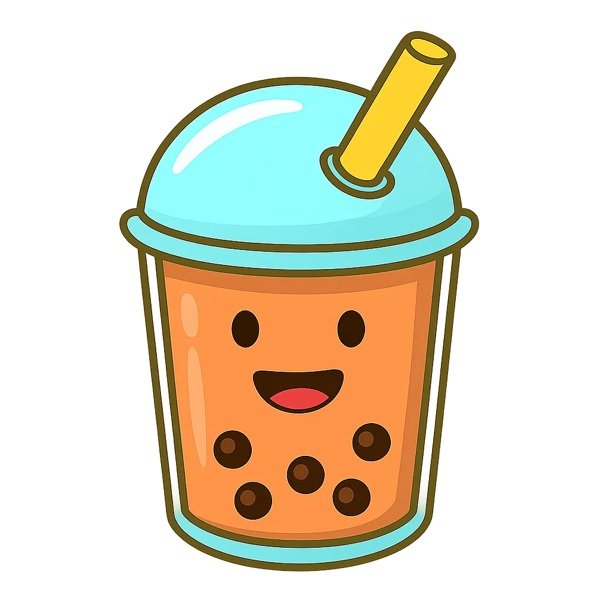

<p align="center">
  
</p>

<h1 align="center">Boba Agent</h1>

<p align="center">
  <b>A self-hosted, gamified kanban board where your team creates Claude Code agents, drags them onto tickets, and watches them work live.</b>
</p>

<p align="center">
  <a href="LICENSE"></a>
  
  
  
</p>

> **Status: early development.** The playable demo works; the Claude Code runner, RBAC and
> multi-server support are being built in the open. Star the repo to follow along.

## What is Boba Agent?

Boba Agent is an open-source **multi-agent IDE for Claude Code** with the look and feel of a
retro video game. You run it on your own server (a VPS, a homelab, a laptop), your teammates
open it in the browser, and everyone shares one live board:

- **Agents are boba characters.** Each one is a Claude Code persona: a system prompt, a set of
  [Agent Skills](https://docs.claude.com/en/docs/claude-code/skills), a model and a permission
  mode. Give them a name, a role ("Dev", "Reviewer", "SEO"…), a sprite and a colour.
- **Tickets are little papers pinned on a wooden board**, coloured by stage
  (to do → doing → PR review → done).
- **Drag an agent onto a ticket and it starts working**: a fresh git worktree and branch, a
  headless Claude Code session, a live transcript, then a pull request.
- **The PR column has a reviewer agent.** Every PR that lands there is reviewed automatically
  with the reviewer's skills: approved PRs move to Done, rejected ones go back with feedback.
- **Everything is visible**: who started what, every tool call, every review round, cost and
  tokens, in a searchable history timeline.
- **Gamified**: agents spin while they work, level up with XP, celebrate finished work; pearls,
  sound effects and an optional chiptune soundtrack.
- **Team-ready**: users with roles (owner, admin, member, viewer), live presence, custom tabs
  per purpose (Dev, Review, SEO, Infra…) with their own columns.

## Quick start

```bash
# from source (Rust ≥ 1.85, Node ≥ 22, pnpm)
git clone https://github.com/Flotapponnier/boba-agent && cd boba-agent
(cd web && pnpm i && pnpm build)
cargo run --release -p boba-server
# open http://localhost:7777 and create the owner account
```

Without `ANTHROPIC_API_KEY` Boba Agent runs in **demo mode**: agents simulate their work so you
can try the whole flow. With a key and the [`claude` CLI](https://docs.claude.com/en/docs/claude-code)
installed, agents run real Claude Code sessions in your repositories.

## How it works

A single Rust binary (axum + SQLite) serves the React UI, a REST + WebSocket API, and drives
Claude Code in headless `stream-json` mode, one git worktree per run. See
[docs/ARCHITECTURE.md](docs/ARCHITECTURE.md) and [docs/API.md](docs/API.md).

## How is it different?

| | Boba Agent | Single-user agent managers (Claude Squad, Conductor, Vibe Kanban…) | Hosted agent platforms (GitHub Agent HQ, Cursor, Devin…) |
|---|---|---|---|
| Self-hosted for a whole team | ✅ | Runs on your machine, one user | ❌ vendor-hosted control plane |
| Personas with their own skills | ✅ | Partly | Partly |
| Auto-review column for PRs | ✅ | ❌ | Separate review products |
| Live shared board + history | ✅ | ❌ | ✅ |
| Open source | MIT | Varies | ❌ |

## FAQ

**Is Boba Agent an official Anthropic product?** No. It is an independent open-source project
that drives the Claude Code CLI.

**Can my team share one Claude Pro/Max subscription through it?** No. Use an organisation API
key (or Bedrock/Vertex) on shared servers; Anthropic's terms reserve subscriptions for individual use.

**Does it support other agents than Claude Code?** Not yet. The runner is a trait, so other CLIs can be added.

**Where do the boba characters come from?** From [Bobavim](https://github.com/Flotapponnier/Bobavim),
the Vim speedrun game by the same author.

## Roadmap

- [x] Playable game UI with demo runner
- [ ] Claude Code runner (worktrees, stream-json, PRs via `gh`)
- [ ] Auto-review column with verdicts
- [ ] Users, roles, invitations
- [ ] Remote runners (multi-server)
- [ ] Desktop app (Tauri)

## Contributing

See [CONTRIBUTING.md](CONTRIBUTING.md). Issues and PRs welcome.

## License

[MIT](LICENSE). Character art from Bobavim, by the same author.
